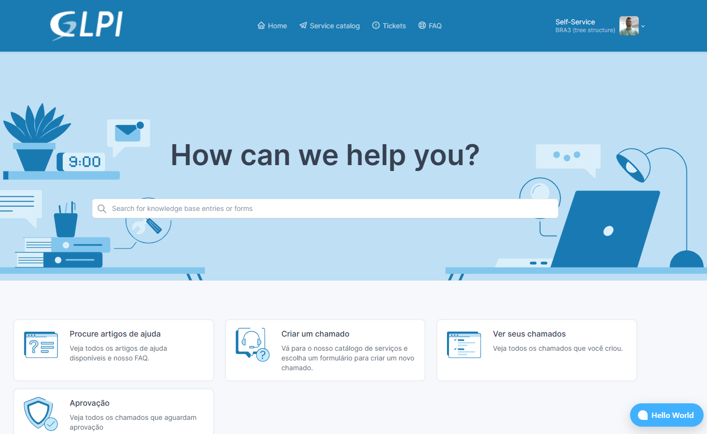
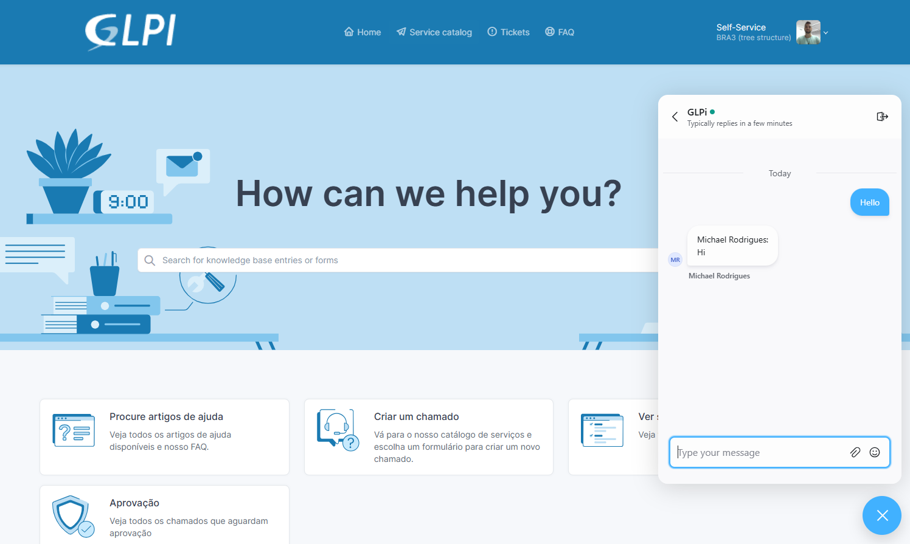
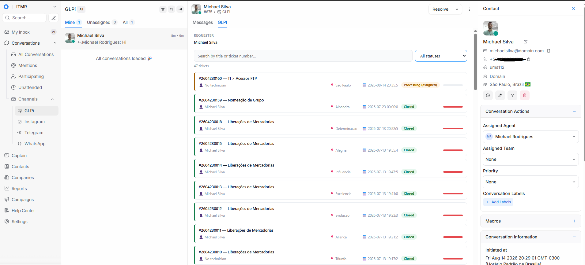
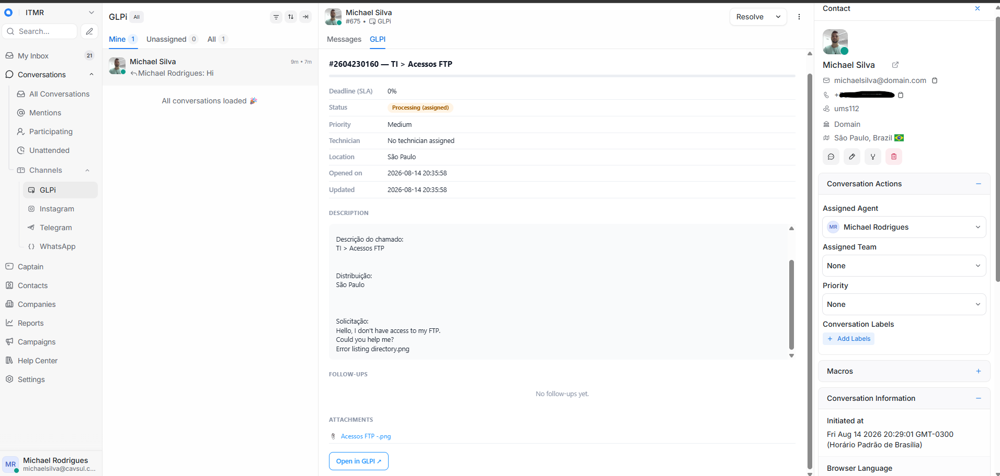
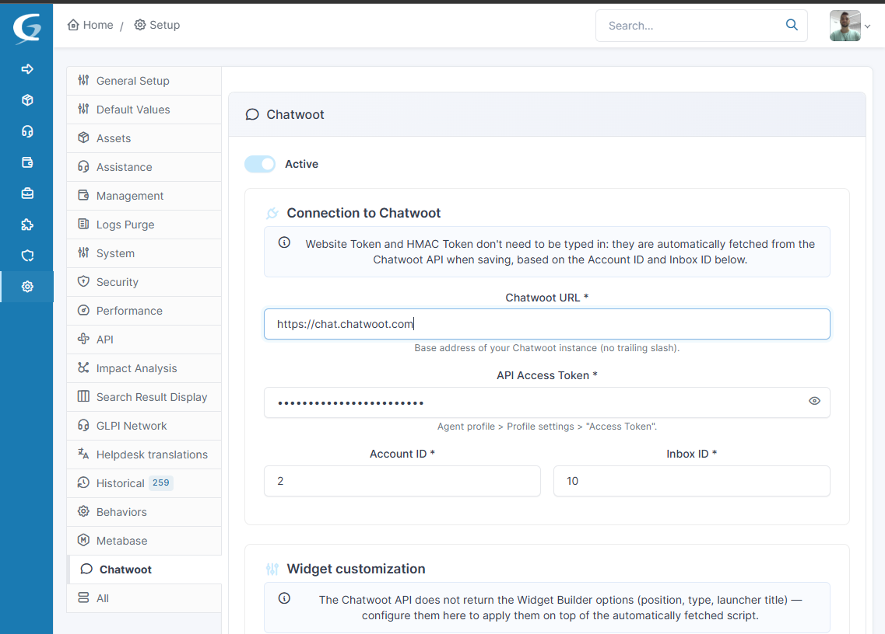
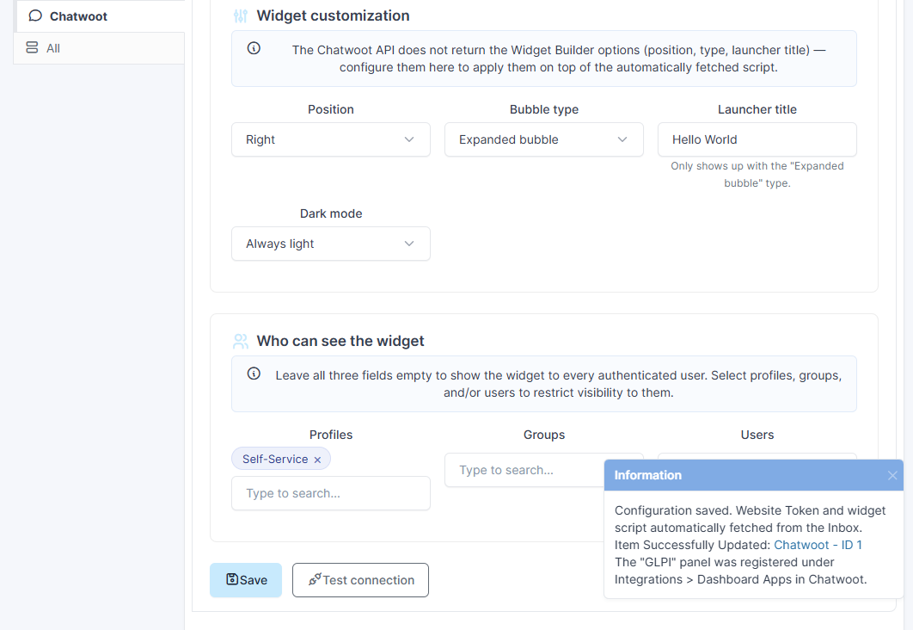
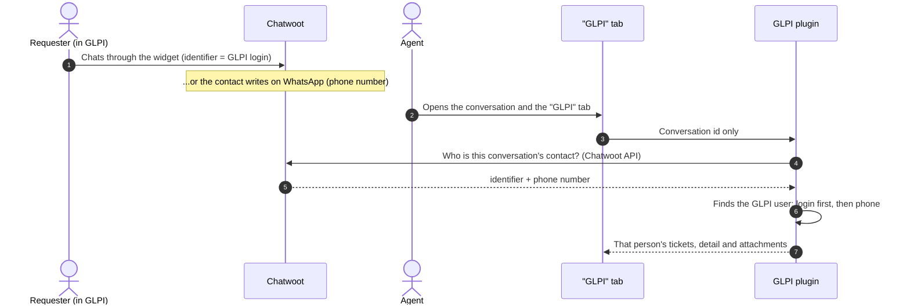

<p align="center">
  
</p>

<h1 align="center">Chatwoot for GLPI</h1>

<p align="center">
  <b>A live chat widget inside GLPI, and a ticket panel inside Chatwoot.</b><br>
  Requesters chat without leaving GLPI. Agents see the requester's tickets without leaving the conversation.
</p>

<p align="center">
  <a href="https://github.com/MichaelRodriguesOficial/Chatwoot-GLPi/releases/latest"></a>
  <a href="https://github.com/MichaelRodriguesOficial/Chatwoot-GLPi/actions/workflows/ci.yml"></a>
  
  
  
  <a href="LICENSE"></a>
  <a href="https://github.com/sponsors/MichaelRodriguesOficial"></a>
</p>

<p align="center">
  <a href="#installation">Installation</a> ·
  <a href="#configuration">Configuration</a> ·
  <a href="#security">Security</a> ·
  <a href="#troubleshooting">Troubleshooting</a> ·
  <a href="CHANGELOG.md">Changelog</a> ·
  <a href="#support">Support ☕</a>
</p>

---

## ✨ Highlights

<table>
<tr>
<td width="50%" valign="top">

### 💬 Chat inside GLPI
The official Chatwoot widget on every authenticated GLPI page, with the user **already identified**
(name, email, phone, photo, city/country) and verified with HMAC. You only type the URL, a token
and two IDs; the Website Token and HMAC Token are fetched for you and kept in sync every hour.

</td>
<td width="50%" valign="top">

### 🎫 Tickets inside Chatwoot
A **"GLPI" tab** next to the conversation, registered automatically. It lists the requester's
tickets with search, status filter and SLA bar, and opens the full detail (timeline, solution,
images, attachments) without leaving Chatwoot. It works for **website widget and WhatsApp**
conversations alike.

</td>
</tr>
<tr>
<td width="50%" valign="top">

### 🔒 Secure by design
Reviewed by the GLPI team before publication. Secrets are encrypted with GLPI's own key, the
contact is resolved **server-side from Chatwoot**, links are short-lived and signed, and the
security logic is covered by tests in CI.

</td>
<td width="50%" valign="top">

### 🎛️ You decide who sees what
Show the widget only to some profiles, groups or users. Keep technicians' internal notes out of
Chatwoot (default) or opt in. Optionally restrict the panel to chosen entities.

</td>
</tr>
</table>

## 📸 Screenshots

**In GLPI**: the widget appears on every authenticated page, ready to chat.

| Widget bubble on the GLPI portal | Conversation open, message sent and answered |
|---|---|
|  |  |

**Inside Chatwoot**: the "GLPI" tab, right next to "Messages".

| Requester's ticket list | Full ticket detail, without leaving the conversation |
|---|---|
|  |  |

**Configuration**: Setup > General > Chatwoot, no manual token copy/pasting.

| Connection settings | Customization, permissions and panel security |
|---|---|
|  |  |

## 🧭 How it works



1. A logged-in GLPI user opens the widget. The plugin identifies them to Chatwoot with their GLPI
   login as `identifier` (HMAC-verified), plus name, email, phone and photo.
2. An agent opens the conversation in Chatwoot, whether it came from the widget or from WhatsApp, and
   clicks the **GLPI** tab.
3. The tab sends GLPI only the **conversation id**. GLPI asks the Chatwoot API who that conversation's
   contact is, then looks the person up by **login** first and **phone number** second (Phone,
   Mobile phone and Phone 2, comparing digits only).
4. The agent sees that person's tickets and can open any of them, with attachments, right there.

<a id="installation"></a>

## 📦 Installation

**Requirements**

| | |
|---|---|
| **GLPI** | 11.x ([why not 10.x?](#troubleshooting)) |
| **PHP** | 8.1+ |
| **Chatwoot** | Self-hosted or cloud, with a Website inbox |
| **API Access Token** | From a Chatwoot **administrator** (or an agent who belongs to every inbox where the GLPI tab is used, e.g. website *and* WhatsApp) |

**Steps**

1. Download `chatwoot-x.y.z.zip` from the [latest release](https://github.com/MichaelRodriguesOficial/Chatwoot-GLPi/releases/latest).
2. Extract it into GLPI's `plugins/` folder. The zip contains a `chatwoot/` directory.
3. Go to **Setup > Plugins**, then install and enable **Chatwoot**.
4. Go to **Setup > General > Chatwoot** and configure it (next section).

<details>
<summary><b>Updating to a new version</b></summary>

Replace the folder in one step, so GLPI never sees it half-copied. While files are being copied,
GLPI logs a harmless `Unable to load plugin "chatwoot" information` warning.

```bash
cd /path/to/glpi                         # the folder that contains plugins/
unzip -q chatwoot-x.y.z.zip -d ../chatwoot-new
mv plugins/chatwoot ../chatwoot-old && mv ../chatwoot-new/chatwoot plugins/chatwoot
rm -rf ../chatwoot-old ../chatwoot-new
```

Then open **Setup > Plugins** and click **Update** if GLPI asks for it. Upgrading from 1.0.0 keeps
the panel already registered in Chatwoot working.

</details>

<a id="configuration"></a>

## ⚙️ Configuration

**Setup > General > Chatwoot**

| Field | Where to find it in Chatwoot |
|---|---|
| **Chatwoot URL** | Your instance address, e.g. `https://chat.yourcompany.com` |
| **API Access Token** | Profile settings > Access Token, preferably an **administrator's** |
| **Account ID** | In the dashboard URL: `/app/accounts/{id}/...` |
| **Inbox ID** | Settings > Inboxes > your Website inbox |

Click **Test connection**, then **Save**. On save, the plugin:

- fetches the **Website Token** and **HMAC Token** of the inbox (no copy/paste);
- registers the **"GLPI" tab** under Integrations > Dashboard Apps in Chatwoot.

The API token field is always shown blank after saving. Leave it blank to keep the stored token.

<details>
<summary><b>All options</b></summary>

| Section | Option | Default |
|---|---|---|
| **Widget** | Enable widget | off |
| | Position (left / right) | right |
| | Bubble type (standard / expanded) | expanded |
| | Launcher title | empty |
| | Dark mode (auto / light / dark) | auto |
| **Who sees the widget** | Profiles, Groups, Users | everyone authenticated |
| **GLPI tab security** | Show internal/private follow-ups to Chatwoot agents | off |
| | Restrict the panel to specific entities (sub-entities included) | off |
| | Regenerate panel token (revokes the current one) | button |

</details>

## 🌍 Languages

| | |
|---|---|
| **Configuration screen** | GLPI gettext (`locales/*.po`/`*.mo`): **en_GB**, **en_US**, **pt_BR**. Follows each GLPI user's language. |
| **GLPI tab in Chatwoot** | JSON dictionaries (`public/dashboard_app/locales/`): **en**, **pt_BR**. Follows the **Chatwoot account's** language automatically, including GLPI values such as status and priority. |

<details>
<summary><b>Adding a language</b></summary>

- **Configuration screen:** copy `locales/chatwoot.pot` to `locales/{code}.po` (e.g. `es_ES.po`),
  translate it, then compile it with `msgfmt {code}.po -o {code}.mo`.
- **GLPI tab:** add `public/dashboard_app/locales/{code}.json` with the same keys as `en.json`, load
  it in `dashboard_app.php` (`$dicts_json`), and add the code to the language checks in
  `dashboard_app.js`.

The tab's language comes from `GET /api/v1/accounts/{account_id}` (`locale`) and is rendered
server-side from the first byte. GLPI-sourced labels are switched for that single request only
(`Config::applyRequestLanguage()`), so no real GLPI session is touched.

</details>

<a id="security"></a>

## 🔐 Security

Version 1.0.1 fixes every finding of the GLPI team's pre-publication security review
([details in the changelog](CHANGELOG.md)).

| Concern | How it's handled |
|---|---|
| **Stored secrets** | API Access Token, HMAC Token and panel token are encrypted with `GLPIKey` and re-encrypted by `security:change_key` (`Hooks::SECURED_FIELDS`). None is ever sent back to the browser. |
| **Who the contact is** | The tab sends only the conversation id. The contact is fetched **server-side from the Chatwoot API**, so a leaked panel token can't be used to name an arbitrary GLPI user. |
| **Panel authorization** | Panel token **plus** a 5-minute capability bound to one GLPI user and one conversation, both sent as **headers**, never in URLs. `Referrer-Policy: no-referrer`. Token can be regenerated anytime. |
| **Attachments** | Per-document signed links (user + ticket + document, 10 min). Ownership re-checked on every download. Inline only for images (not SVG) and PDF, like GLPI core; everything else is a download, with `nosniff` and a CSP sandbox. |
| **Internal notes** | Private follow-ups and their files stay out of Chatwoot unless explicitly enabled. |
| **Accounts & scope** | Only active, non-deleted GLPI users. Optional entity restriction. Identity lookups rate-limited per IP and logged. |
| **Widget code** | Always the static, documented `sdk.js` loader. Nothing returned by the Chatwoot API is executed. |
| **Outbound calls** | `http`/`https` only, TLS verified, no redirects while carrying the API token, URL validated on save. |
| **Framing & messages** | `frame-ancestors` limited to your Chatwoot. `postMessage` accepted only from its origin. |
| **Rendering** | Ticket content converted to plain text server-side and inserted with `textContent`. |

<a id="troubleshooting"></a>

## 🛠️ Troubleshooting

<details>
<summary><b>The "GLPI" tab doesn't appear in Chatwoot</b></summary>

Check under **Integrations > Dashboard Apps** whether "GLPI" exists. If not, save the plugin
configuration again: the tab is registered on save, once the plugin reaches the inbox successfully.
</details>

<details>
<summary><b>The tab is empty for WhatsApp (or another inbox) conversations</b></summary>

The API token's user can't see that inbox. Use an administrator's token, or add that agent to the
inbox. The person also needs a matching login or phone number (Phone, Mobile phone or Phone 2) in
GLPI.
</details>

<details>
<summary><b>"Invalid or unconfigured integration token"</b></summary>

The panel token changed (for example after **Regenerate panel token**) and Chatwoot still has the
old URL. Save the configuration again so the Dashboard App is re-registered, then reload Chatwoot.
</details>

<details>
<summary><b>Where are the errors logged?</b></summary>

In GLPI's `files/_log/php-errors.log`, prefixed with `[chatwoot]`.
</details>

<details>
<summary><b>Why GLPI 11 only?</b></summary>

GLPI 10 uses a different bootstrap and routing model (`inc/includes.php` in every script, no
`public/` convention, no `Firewall`/`SessionManager` APIs for session-less endpoints). Supporting
both would mean two plugin architectures, so installation is blocked on versions older than 11.0.0.
</details>

## 🧪 Development

The security-relevant logic is covered by a PHPUnit suite, run by [CI](.github/workflows/ci.yml) on
PHP 8.1 to 8.4. It tests capabilities, signed document links, the inline allow-list, the
attachments query scope, conversation-based identity, URL validation and the 1.0.0 → 1.0.1
migration.

```bash
composer install
vendor/bin/phpunit
```

`tests/bootstrap.php` provides minimal stand-ins for the GLPI classes involved. Its `GLPIKey` uses
the same XChaCha20-Poly1305 scheme as GLPI, so tokens are tested with real encryption.

<details>
<summary><b>File structure</b></summary>

```
chatwoot/
├── setup.php                        Plugin metadata, hooks, public route registration
├── hook.php                         Install/uninstall, migrations, automatic action
├── logo.png                         Plugin logo (shown in GLPI's plugin list)
├── src/Config.php                   Connection, widget, permissions, tickets, security
├── templates/config.html.twig       Configuration screen
├── front/                           Configuration page and form handler
├── ajax/                            Test connection, permission pickers, contact sync
├── public/
│   ├── js/chatwoot.js.php           Loads and identifies the widget on GLPI pages
│   ├── avatar.php                   Profile photo proxy (signed token)
│   └── dashboard_app/               The "GLPI" tab shown inside Chatwoot
│       ├── dashboard_app.php        Page shell (language resolved server-side)
│       ├── dashboard_identify.php   Conversation → contact → GLPI user → capability
│       ├── dashboard_tickets.php    Ticket list (JSON)
│       ├── dashboard_ticket_detail.php  Ticket detail, timeline, attachments (JSON)
│       ├── dashboard_document.php   Attachment/image download (signed links)
│       └── css/ js/ locales/        Panel assets and translations
├── locales/                         gettext: chatwoot.pot, en_GB/en_US/pt_BR .po/.mo
└── tests/ · .github/                PHPUnit suite and CI (not in the release zip)
```

Database tables: `glpi_plugin_chatwoot_configs` (configuration), `glpi_plugin_chatwoot_targets`
(widget permissions and panel entities), `glpi_plugin_chatwoot_access_log` (short rolling log used
to throttle identity lookups).

</details>

<a id="support"></a>

## ☕ Support the project

**Enjoying the plugin?** It's an independent, open-source project, built and maintained with care
so that GLPI and Chatwoot teams can work together without switching screens. If it saves your team
time, you can buy me a coffee: it helps keep the plugin up to date with new GLPI and Chatwoot
versions. It's completely optional. A ⭐ on the repository, a bug report, an idea or a pull request
help just as much.

**Curtiu o plugin?** É um projeto independente e de código aberto. Se ele facilita o dia a dia da sua
equipe, você pode me pagar um café 💚. Isso ajuda a manter o plugin atualizado com as novas versões
do GLPI e do Chatwoot. É totalmente opcional: uma ⭐ no repositório, um relato de bug, uma ideia ou
um PR ajudam tanto quanto.

<table>
<tr>
<th width="50%">🌎 From anywhere</th>
<th width="50%">🇧🇷 Do Brasil, via Pix</th>
</tr>
<tr>
<td align="center" valign="middle">

<a href="https://github.com/sponsors/MichaelRodriguesOficial"></a>

<sub>One-time or monthly, any amount.<br>GitHub charges no fees on personal sponsorships.</sub>

</td>
<td align="center" valign="middle">

<br>
<sub>Aponte a câmera do app do seu banco</sub>

<details>
<summary><sub>Pix copia e cola</sub></summary>

```
00020126980014br.gov.bcb.pix01363d43ffaa-4b56-45ed-b038-ba7407c0a9750236Cafe para o plugin Chatwoot for GLPI5204000053039865802BR5917MICHAEL RODRIGUES6009SAO PAULO62070503***63040513
```

</details>

</td>
</tr>
</table>

## 📄 License

[AGPL-3.0-or-later](LICENSE). Made by **Michael Rodrigues** ·
[github.com/MichaelRodriguesOficial](https://github.com/MichaelRodriguesOficial)
